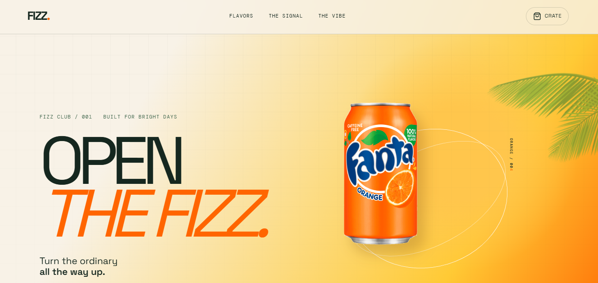

# FIZZ — Taste the Fizz

Una landing page vibrante e interactiva para una marca de soda cítrica. FIZZ combina tipografía editorial, gradientes naranjas atrevidos, movimiento enfocado en el producto y una experiencia de sabores juguetona en una experiencia web de una sola página pulida.

## Vista previa de la landing page de FIZZ



## Sobre el proyecto

FIZZ está diseñado como una landing page de bebidas de alta energía con una jerarquía visual fuerte y un hero enfocado en el producto. La experiencia abre con una lata real de FIZZ, una rodaja de naranja rotando, anillos animados y movimiento basado en scroll antes de transicionar hacia el descubrimiento de sabores y la sección interactiva Signal.

La dirección visual combina tonos cítricos cálidos con tipografía verde profunda, titulares editoriales de gran tamaño y layouts responsivos que se adaptan a desktop y móvil.

## Características

- Hero enfocado en producto con una lata de FIZZ visible.
- Animación de rodaja de naranja rotando al cargar la página.
- Movimiento basado en scroll para la rodaja de naranja y la composición del producto.
- Navegación responsiva con soporte para menú móvil.
- Tarjetas de sabores con imágenes de producto y notas de cata.
- Sección interactiva "The Signal" que cambia sabor, color, producto y copy.
- Interacciones de añadir al crate con feedback del carrito (drawer).
- Layout responsivo para desktop y móvil.
- Estructura semántica accesible, botones, labels y texto alternativo en imágenes.

## Secciones de la vista previa

- **Hero** — Open the Fizz con el producto, la rodaja de naranja y el sistema visual animado.
- **Flavors** — Explora las frecuencias de sabor disponibles.
- **The Signal** — Selecciona un sabor y sintoniza la exhibición de producto en vivo.
- **The Vibe** — Historia de la marca y dirección visual.
- **Footer** — Mensaje de cierre, navegación y links sociales.

## Stack técnico

- Next.js
- React
- TypeScript
- Tailwind CSS
- GSAP y ScrollTrigger
- Lucide React
- Animaciones CSS y primitivas de layout responsivo

## Primeros pasos

Clona el repositorio e instala las dependencias:

```bash
git clone <your-repository-url>
cd <your-project-folder>
pnpm install
pnpm dev